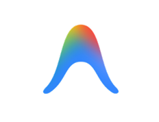
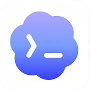
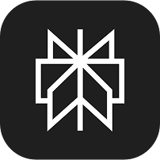
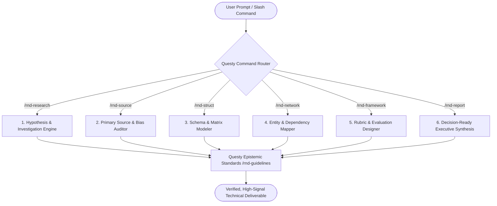

<div align="center">

  

  # QUESTY
  
  ### The Autonomous R&D and Strategic Intelligence Engine for AI Agents

  <p align="center">
    <b>Equipping Google Antigravity, Anthropic Claude, GitHub Copilot, OpenAI Codex, and Perplexity with institutional-grade research capabilities.</b>
  </p>

  <p align="center">
    <a href="LICENSE"></a>
    <a href="https://antigravity.google"></a>
    <a href="https://openai.com"></a>
    <a href="https://anthropic.com"></a>
    <a href="https://github.com/features/copilot"></a>
    <a href="https://perplexity.ai"></a>
  </p>

  <p align="center">
    <a href="#why-questy">Why Questy?</a> &bull;
    <a href="#supported-native-agent-ecosystem">Ecosystem</a> &bull;
    <a href="#the-7-universal-slash-commands">7 Slash Commands</a> &bull;
    <a href="#quickstart">Quickstart</a> &bull;
    <a href="#system-architecture">Architecture</a> &bull;
    <a href="#enterprise-rigor-and-integrity">Enterprise Rigor</a>
  </p>

</div>

---

<div align="center">
  <h3>Supported Native Agent Ecosystem</h3>

  <table border="0" align="center">
    <tr>
      <td align="center" width="130" style="border: none;">
        <br/>
        <b>Google Antigravity</b><br/>
        <sub>Native Plugin &amp; Skills</sub>
      </td>
      <td align="center" width="130" style="border: none;">
        <br/>
        <b>OpenAI Codex</b><br/>
        <sub>Agents &amp; Prompt Chains</sub>
      </td>
      <td align="center" width="130" style="border: none;">
        <br/>
        <b>Anthropic Claude</b><br/>
        <sub>Claude Code &amp; Projects</sub>
      </td>
      <td align="center" width="130" style="border: none;">
        <br/>
        <b>GitHub Copilot</b><br/>
        <sub>Instruction Engine</sub>
      </td>
      <td align="center" width="130" style="border: none;">
        <br/>
        <b>Perplexity AI</b><br/>
        <sub>Spaces System Prompt</sub>
      </td>
    </tr>
  </table>
</div>

---

## Why Questy?

Modern AI developer agents excel at synthesizing code, but often falter when solving **mission-critical R&D questions**: they lean into hallucinations, accept shallow assertions without verification, and deliver disjointed advice.

**Questy bridges the gap between raw LLM generation and Tier-1 scientific and technical rigor.** It embeds an institutional research protocol directly into your agent's reasoning loop:

* **Evidentiary Rigor**: Every technical claim is backed by traceable primary sources and verified benchmarks.
* **Zero-Bias Isolation**: Avoids premature convergence; proactively explores edge cases, counter-hypotheses, and trade-offs.
* **Modular Pipeline**: Decouples hypothesis framing, source critique, structural modeling, and executive synthesis into 7 dedicated skills.
* **Universal Portability**: Write your specifications once; run identically across Antigravity, Claude Code, GitHub Copilot, Cursor/Codex, and Perplexity.

---

## The 7 Universal Slash Commands

Whenever Questy is installed in your project, simply type **`/`** in your AI chat bar to trigger any of the 7 modular runbooks:

| Command | Module | Function | Trigger Use Case |
| :--- | :--- | :--- | :--- |
| **`/rnd-research`** | `rnd-research` | **Deep Multi-Angle Investigation** | Systematic hypothesis testing, real-time web investigation, and empirical evidence gathering. |
| **`/rnd-struct`** | `rnd-struct` | **Structural Modeling & Schemas** | Organizing unstructured data into taxonomies, comparison matrices, schemas, and trade-off trees. |
| **`/rnd-source`** | `rnd-source` | **Source Audit & Bias Detection** | Auditing provenance, verifying citations against primary source documents, and scoring evidentiary weight. |
| **`/rnd-report`** | `rnd-report` | **Executive Decision-Ready Synthesis** | Transforming complex findings into boardroom-ready briefs, executive summaries, and action plans. |
| **`/rnd-network`** | `rnd-network` | **Entity & Dependency Mapping** | Graphing multi-stakeholder ecosystems, technical dependencies, supply networks, and influence maps. |
| **`/rnd-framework`** | `rnd-framework` | **Evaluation & Rubric Engine** | Designing repeatable scoring models, benchmarking frameworks, and testing procedures. |
| **`/rnd-guidelines`** | `rnd-guidelines` | **Analytical Rigor & Epistemic Standards** | Enforcing zero-bias isolation, source transparency, and uncertainty disclosure across all turns. |

---

## Live Agent Experience

```bash
# In your Google Antigravity or Claude Code chat:
> /rnd-research What are the primary thermal and latency bottlenecks of silicon photonics in edge AI clusters?

[Questy R&D Engine Activated: Mode = Zero-Bias Investigation]
1. Framing Hypothesis & Context Horizon...
2. Cross-referencing primary IEEE / Optica benchmarks & packaging thermal dissipation data...
3. Auditing competing claims (Co-Packaged Optics vs. Pluggable Optical Transceivers)...
4. Synthesizing structural trade-off matrix: Energy/bit vs. Insertion loss vs. Cost per channel.
5. Decision-ready executive memo rendered.
```

---

## Quickstart

### 1. Google Antigravity (Preferred)
```bash
git clone https://github.com/parthongit89/Questy_.git
cd Questy_
```
Open the folder in **Google Antigravity**. Antigravity automatically detects `.agents/skills/` and the `.agents/plugins/questy/` plugin.
Type **`/`** in the chat box to see all 7 commands auto-complete instantly.

---

### 2. Anthropic Claude Code
```bash
# Claude Code automatically detects the pre-configured .claude/commands/ and CLAUDE.md
claude

# Inside Claude Code CLI:
> /rnd-research "Evaluate zero-knowledge proof throughput on WASM runtimes"
```

---

### 3. GitHub Copilot & Cursor
* **GitHub Copilot**: Pre-configured via `.github/copilot-instructions.md`. Simply ask Copilot Chat to *"Apply /rnd-research"* or *"Execute /rnd-report"*.
* **Cursor / OpenAI Codex**: Pre-configured via `.cursorrules` in repository root.

---

### 4. Perplexity AI
1. Go to your **Perplexity Spaces / Collections**.
2. Open `perplexity/SYSTEM_PROMPT.md` in this repository.
3. Paste the contents into the Space System Prompt field.
4. Prefix queries with `[RESEARCH]`, `[STRUCT]`, or `[REPORT]`.

---

## System Architecture



---

## Repository Structure

```text
Questy_/
├── .agents/
│   ├── plugins/questy/          # Antigravity Plugin manifest & rules
│   │   ├── plugin.json
│   │   └── rules/AGENTS.md
│   └── skills/                  # Antigravity 7 native skills
│       ├── rnd-framework/
│       ├── rnd-guidelines/
│       ├── rnd-network/
│       ├── rnd-report/
│       ├── rnd-research/
│       ├── rnd-source/
│       └── rnd-struct/
├── .claude/
│   └── commands/                # Claude Code CLI slash commands
├── .github/
│   └── copilot-instructions.md  # GitHub Copilot custom instructions
├── assets/                      # Brand logos & visuals
│   ├── questy-logo.png
│   ├── antigravity.png
│   ├── codex.png
│   ├── claude.png
│   ├── copilot.png
│   └── perplexity.png
├── perplexity/
│   └── SYSTEM_PROMPT.md         # Perplexity Space system prompt
├── .cursorrules                 # Cursor & Codex configuration
├── CLAUDE.md                    # Claude runtime instructions
├── LICENSE                      # MIT License
└── README.md                    # Product Showcase Documentation
```

---

## Enterprise Rigor and Integrity

Every inquiry conducted through Questy follows non-negotiable evidentiary tenets:
1. **Separation of Fact & Speculation**: Empirical benchmarks are cleanly separated from probabilistic models and assumptions.
2. **Provenance Traceability**: Citations prioritize peer-reviewed literature, official documentation, regulatory filings, and primary codebases.
3. **No Hallucinated Citations**: Antigravity and Claude models are bound by strict anti-hallucination guardrails.

---

## Contributing

Contributions to expand Questy skills, add new agent sidecars, or refine evaluation frameworks are welcome:
1. Fork the Project: `https://github.com/parthongit89/Questy_.git`
2. Create your Feature Branch (`git checkout -b feature/NewSkill`)
3. Commit your Changes (`git commit -m 'feat: Add new R&D skill'`)
4. Push to the Branch (`git push origin feature/NewSkill`)
5. Open a Pull Request

---

## License

Distributed under the **MIT License**. See [`LICENSE`](LICENSE) for more information.

<div align="center">
  <sub>Maintained by the Questy Open Source Contributors for the Next Generation of AI Engineers.</sub>
</div>
